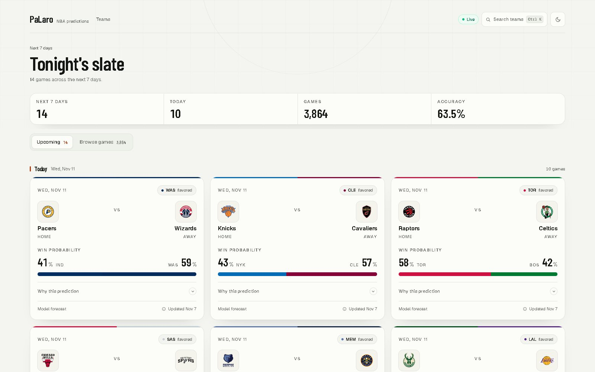
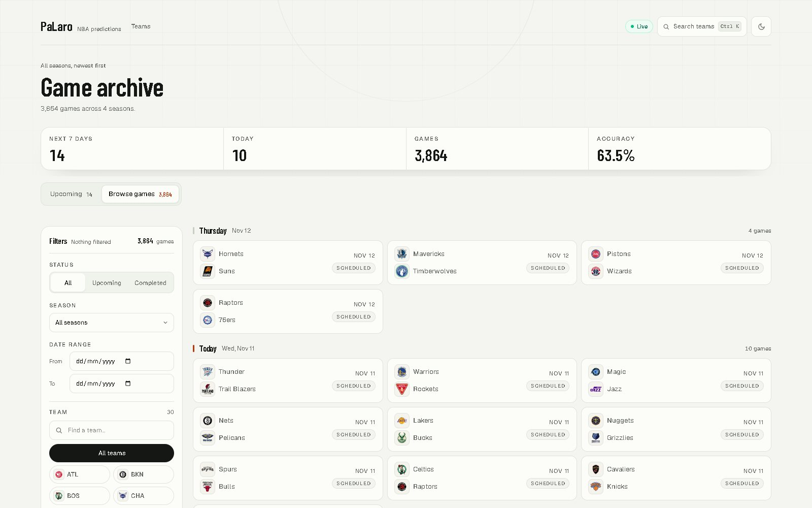
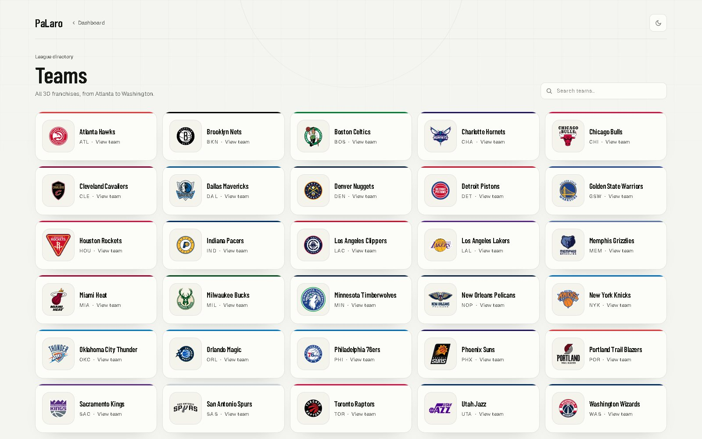
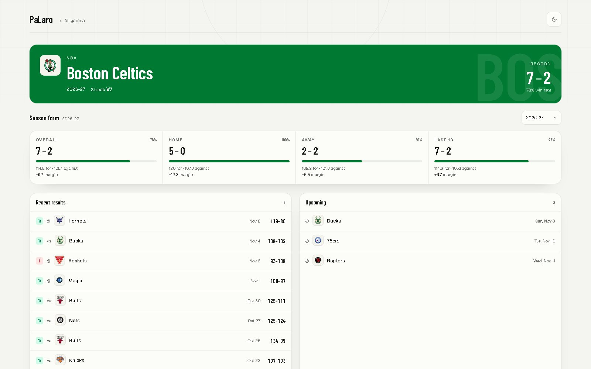
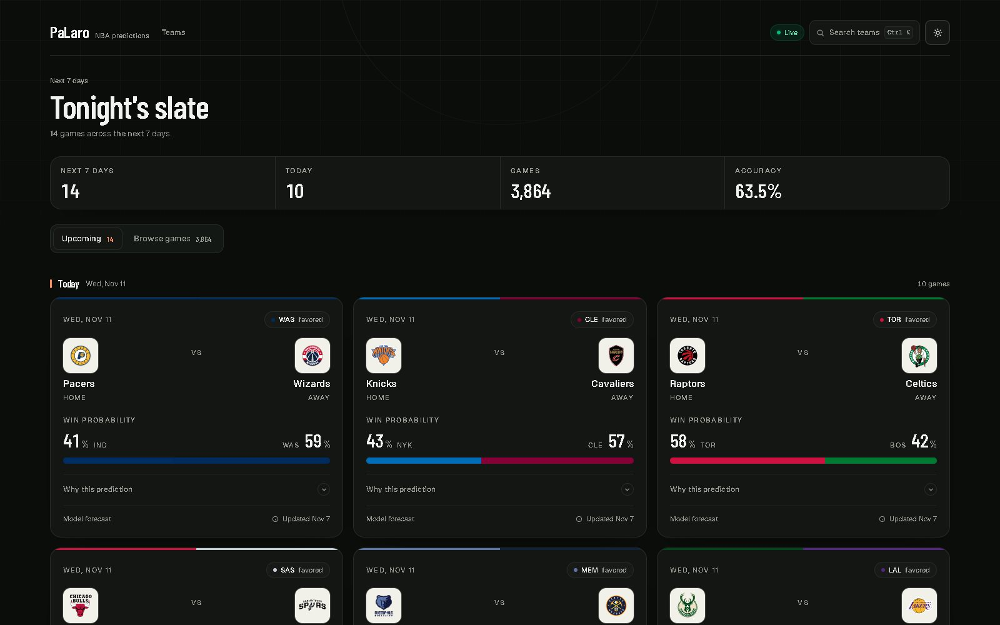

# 🏀 PaLaro — NBA Game Prediction Platform

[](https://github.com/SneakySep/PaLaro/actions/workflows/ci.yml)
[](LICENSE)

PaLaro is a full-stack NBA game prediction platform. An XGBoost model is trained
on historical results and team form, served through FastAPI, and presented in a
wide, responsive Next.js dashboard with explanations, team profiles, and the
full game archive.



## Features

- **Upcoming slate** — the next seven days of predictions, grouped by date, with
  home/away win probabilities and model metadata.
- **Explainable forecasts** — each prediction breaks down the feature
  contributions that moved the model toward the home or away side.
- **Browse the archive** — 3,800+ games filterable by status, team, season, and
  date range, with URL-synced filters and pagination.
- **Sticky filter rail** — on wide screens the filters stay in view; the team
  picker searches all 30 franchises and shows their official logos.
- **Team profiles** — season-aware records, home/away splits, streaks, recent
  form, and upcoming games for every team.
- **Team directory** — a searchable `/teams` page covering the whole league.
- **Official team identity** — all 30 primary logos are bundled locally, with a
  color/abbreviation fallback if an asset is unavailable.
- **Dark mode and accessibility** — keyboard command palette, focus-trapped
  drawer, visible focus states, semantic tabs, and reduced-motion support.
- **Responsive layout** — one column on phones, two on tablets, and three
  prediction columns in the 1440px wide desktop shell.

## Screenshots

| Browse games | Teams directory |
| --- | --- |
|  |  |

| Team profile | Dark mode |
| --- | --- |
|  |  |

## Stack

| Layer | Technology |
| --- | --- |
| ML / Data | Python, Pandas, Scikit-Learn, XGBoost |
| API | FastAPI + Uvicorn |
| Frontend | Next.js 16 (App Router), React 19, Tailwind CSS 4, Framer Motion, TanStack Query |
| Database | PostgreSQL 16 (Docker) |
| Data ingestion | `nba_api` (stats.nba.com); provider abstraction for API-NBA/Sportradar |

## Monorepo layout

```
PaLaro/
├── backend/
│   ├── app/            # FastAPI app (API, DB, services)
│   ├── ml/             # trainer, inference wrapper, model artifacts
│   ├── data_pipeline/  # ingestion + feature engineering
│   ├── tests/
│   └── scripts/        # ingest.py, train.py, sync_scoreboard.py
├── frontend/           # Next.js + Tailwind dashboard
├── docs/screenshots/   # README images
├── docker-compose.yml  # PostgreSQL
└── Makefile            # dev shortcuts
```

## Quick start (Windows PowerShell)

The commands below use PowerShell. On macOS/Linux, use `cp` and activate the
virtual environment with `source .venv/bin/activate`.

```powershell
# 1. Environment files (never commit these)
Copy-Item .env.example .env
Copy-Item .env.example backend\.env
Copy-Item .env.example frontend\.env.local

# 2. Database (requires Docker)
docker compose up -d db

# 3. Backend
cd backend
py -3 -m venv .venv
.\.venv\Scripts\Activate.ps1
pip install -r requirements.txt -r requirements-dev.txt
alembic upgrade head
uvicorn app.main:app --reload --port 8000

# 4. Frontend (separate terminal)
cd frontend
npm install
npm run dev
```

Open `http://localhost:3000` (frontend) and `http://localhost:8000/docs` (API).
The root `.env` feeds Docker Compose; `backend/.env` feeds FastAPI; and
`frontend/.env.local` provides `NEXT_PUBLIC_API_URL` to Next.js. The frontend
falls back to `http://localhost:8000` if that variable is unset.

### Populate data (optional)

From `backend/`, with the virtual environment active:

```powershell
# Historical games + box scores (slow; stats.nba.com rate limits apply)
python -m scripts.ingest --season 2023-24

# Train the model artifact used by /predict
python -m scripts.train --season 2023

# Upcoming schedule for the next 7 days (feeds /predict/upcoming)
python -m scripts.sync_scoreboard --days 7
```

The prediction endpoints return `503` until a trained artifact exists under
`ml/model_artifacts/`.

> **Box scores require `BoxScoreTraditionalV3`.** stats.nba.com stopped
> publishing V2 box scores as of the 2025-26 season; V2 returns an empty frame
> (not an error) for those games. The provider uses V3, which also renamed every
> column (`personId`, `turnovers`, `reboundsTotal`).

> **Serving needs current form.** `/predict/upcoming` derives each team's recent
> form from its last final game. If that game is older than `MAX_REST_DAYS`
> (30), the game is skipped rather than scored on stale features — run the
> scoreboard sync and ingest the current season before expecting predictions.

## Evaluation

A single chronological split gives one number from one arbitrary cutoff, which
is too noisy to trust. Use walk-forward (rolling-origin) validation instead: it
trains on everything before a cutoff, tests on the window after it, then rolls
forward.

```powershell
python -m data_pipeline.training.walk_forward --season 2023 --season 2024 --season 2025 --season 2026 --folds 6
```

Each fold reports accuracy, log-loss, ROC AUC, and the always-pick-home
baseline, so the spread across folds and the edge over baseline are both
visible. Reported results on four seasons (3,731 feature rows):

| Metric | Value |
| --- | --- |
| Accuracy | 0.640 ± 0.039 (6 folds, 1,866 test games) |
| ROC AUC | 0.669 ± 0.062 |
| Baseline (always pick home) | 0.549 |
| Edge over baseline | +9.2 points |

Predictions are point estimates. There is deliberately no confidence interval
on the response: the previous Wilson band was computed from a single sample and
returned roughly `[0.09, 0.97]` for every prediction, which conveys no real
information.

## API

| Method | Endpoint | Description |
| --- | --- | --- |
| GET | `/health` | Service health check |
| GET | `/api/v1/teams` | All known teams |
| GET | `/api/v1/teams/{abbr}` | Team profile; defaults to the latest season. Use `?season=2023` or `?all_seasons=true` to change the scope |
| GET | `/api/v1/games` | Games with optional `status`, `team`, `season`, `date_from`, `date_to`, `limit`, and `offset` filters |
| GET | `/api/v1/seasons` | Seasons present in the database, newest first, with game counts |
| GET | `/api/v1/model/metrics` | Metrics and version metadata for the loaded model artifact |
| GET | `/api/v1/predict/health` | Prediction-service health probe |
| GET | `/api/v1/predict/upcoming?days=7` | Predictions for scheduled games in the next 1–14 days |
| POST | `/api/v1/predict` | Score one game from a supplied feature vector |

`GET /api/v1/games` returns the total number of matching rows in the
`X-Total-Count` header, so the dashboard can paginate without a second request.
Game results are ordered newest-first.

`POST /api/v1/predict` returns `game_id`, `home_team`, `away_team`,
`home_win_prob` (0–1), `model_version`, and feature explanations.

Makefile shortcuts: `make db-up`, `make backend-run`, `make frontend-run`, and
`make setup`.

## Roadmap

1. Skeleton end-to-end (FastAPI ↔ Next.js wiring) ✅
2. DB schema + Alembic migrations ✅
3. Historical ingestion via `nba_api` ✅
4. Feature engineering (rolling, advanced metrics, contextual) ✅
5. XGBoost training + evaluation ✅
6. Prediction API ✅
7. Minimal animated UI ✅
8. Walk-forward validation ✅
9. Wide dashboard, team profiles/directory, and official logos ✅
10. Live data providers + user accounts

## Prerequisites

- Node.js 18+ / 20+ (v24 used here)
- Python 3.11 / 3.12 recommended (XGBoost wheels). Python 3.14 may require a
  source build for the ML stack.
- Docker Desktop (for PostgreSQL)

## Development

CI runs ruff + pytest for the backend and lint + typecheck + build for the
frontend. Backend dependencies install from `backend/requirements.lock.txt` so
CI matches the versions that were tested; `requirements.txt` stays loose and is
the human-edited input.

```powershell
cd backend
ruff check .
pytest -q

cd ..\frontend
npm run lint
npx tsc --noEmit
npm run build
```

## Team logos and license

The source code is licensed under the [MIT License](LICENSE).

The 30 SVG logos under `frontend/public/team-logos/` are official NBA team
marks fetched from the NBA's public logo CDN. They are trademarks of their
respective teams and the NBA, included for team identification only, and are
**not** covered by the MIT license. See
[`frontend/public/team-logos/README.md`](frontend/public/team-logos/README.md)
for details.

NBA game data is retrieved through `nba_api`; use of that data is subject to
the applicable terms of the data provider.
